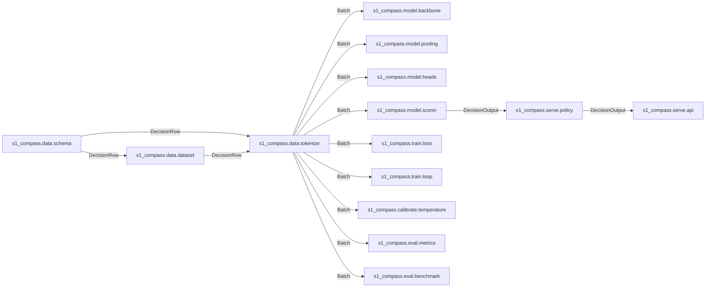

# 1. Contract Summary

| Stage | Input | Output | Exit Criterion |
|---|---|---|---|
| Validate | Raw DecisionRow JSONL | Validated DecisionRow JSONL | Structural and semantic validation passes for all retained rows. |
| Partition | Validated DecisionRow JSONL | Immutable split files and manifest | Related context groups are disjoint across splits. |
| Tokenize | DecisionRow | Batch | Every real option has a nonempty, untruncated span. |
| Initialize | Pinned backbone snapshot | MLX encoder and scalar head | FP32 encoder parity passes. |
| Train | Training and validation Batch streams | Frozen best checkpoint | Validation Brier selection completes with finite values. |
| Calibrate | Frozen checkpoint and calibration Batch stream | Scalar T and calibration.json | Calibration NLL does not increase. |
| Evaluate | Frozen checkpoint, T, test Batch streams | evaluation.json | Every mandatory gate passes. |
| Serve | Validated request | DecisionOutput or typed error | Schema, policy, deadline, and artifact checks pass. |

# 2. Data Contracts

## DecisionRow

```json
{
  "$schema": "https://json-schema.org/draft/2020-12/schema",
  "$id": "https://s1-compass.local/schemas/DecisionRow.json",
  "title": "DecisionRow",
  "type": "object",
  "additionalProperties": false,
  "required": ["id", "state_text", "question", "options", "label", "annotator_confidence", "source"],
  "properties": {
    "id": {"type": "string", "minLength": 1, "maxLength": 128},
    "state_text": {"type": "string", "minLength": 1, "maxLength": 65536},
    "question": {
      "type": "object", "additionalProperties": false,
      "required": ["id", "type", "instructions"],
      "properties": {
        "id": {"type": "string", "minLength": 1, "maxLength": 128},
        "type": {"type": "string", "enum": ["choice", "boolean", "ordinal"]},
        "instructions": {"type": "string", "minLength": 1, "maxLength": 4096}
      }
    },
    "options": {
      "type": "array", "minItems": 2, "maxItems": 8,
      "items": {
        "type": "object", "additionalProperties": false,
        "required": ["id", "description"],
        "properties": {
          "id": {"type": "string", "minLength": 1, "maxLength": 64, "not": {"const": "ABSTAIN"}},
          "description": {"type": "string", "minLength": 1, "maxLength": 2048}
        }
      }
    },
    "label": {"type": "string", "minLength": 1, "maxLength": 64},
    "annotator_confidence": {"type": "number", "minimum": 0, "maximum": 1},
    "source": {"type": "string", "enum": ["human_review", "dataset_name", "adjudicated"]}
  },
  "allOf": [
    {
      "if": {"properties": {"question": {"properties": {"type": {"const": "boolean"}}}}},
      "then": {"properties": {"options": {
        "minItems": 2, "maxItems": 2,
        "items": {"properties": {"id": {"enum": ["false", "true"]}}},
        "allOf": [
          {"contains": {"properties": {"id": {"const": "false"}}, "required": ["id"]}},
          {"contains": {"properties": {"id": {"const": "true"}}, "required": ["id"]}}
        ]
      }}}
    },
    {
      "if": {"properties": {"question": {"properties": {"type": {"const": "ordinal"}}}}},
      "then": {"properties": {"options": {"items": {"properties": {"id": {"pattern": "^(0|-?[1-9][0-9]*)$"}}}}}}
    }
  ],
  "$comment": "schema.py additionally enforces globally unique row IDs, distinct option IDs, label membership in option IDs or ABSTAIN, and contiguous ordinal IDs within signed int32 bounds. Standard JSON Schema cannot express dynamic label membership or uniqueness by object property. Confidence is metadata and never an input feature or loss weight."
}
```

```json
{
  "id": "ticket-00421:urgency",
  "state_text": "Our production account is locked and all customer checkouts are failing.",
  "question": {"id": "urgency", "type": "ordinal", "instructions": "Select urgency: 0 means routine; 1 means impaired service; 2 means production service unavailable."},
  "options": [
    {"id": "0", "description": "Routine request with no service impairment."},
    {"id": "1", "description": "Service is impaired but remains available."},
    {"id": "2", "description": "Production service is unavailable."}
  ],
  "label": "2", "annotator_confidence": 1, "source": "adjudicated"
}
```

## Batch

```pseudocode
Batch := {
    input_ids: int32[N,L],
    attention_mask: int8[N,L],
    option_spans: int32[N,K,2],
    label_idx: int32[N],
    meta: {question_type: str[N], option_ids: list[list[str]][N]}
}
N := batch size; L := max sequence length; K := max real option count
require 1 <= N <= 20 and 1 <= L <= 512 and 2 <= K <= 8
require attention_mask contains only 0 and 1, with contiguous valid tokens then right padding
require every real option span is [start,end), 0 <= start < end <= sum(attention_mask[row])
require every padded option span is [-1,-1]
require length(meta.option_ids[row]) equals real option count
require label_idx = -1 for inference or ABSTAIN; otherwise 0 <= label_idx < real option count
require padded option logits are negative infinity
require labels, source, confidence, and row IDs never enter input_ids

example: Batch := {
    input_ids: [[101,201,202,203,204,102]], attention_mask: [[1,1,1,1,1,1]],
    option_spans: [[[2,3],[4,5]]], label_idx: [1],
    meta: {question_type: ["boolean"], option_ids: [["false","true"]]}
}
```

## DecisionOutput

```json
{
  "$schema": "https://json-schema.org/draft/2020-12/schema",
  "$id": "https://s1-compass.local/schemas/DecisionOutput.json",
  "title": "DecisionOutput", "type": "object", "additionalProperties": false,
  "required": ["answers", "model", "calibration_version", "latency_ms"],
  "properties": {
    "answers": {"type": "object", "minProperties": 1, "maxProperties": 20, "propertyNames": {"minLength": 1, "maxLength": 128}, "additionalProperties": {"$ref": "#/$defs/TypedAnswer"}},
    "model": {"type": "string", "pattern": "^s1-compass-modernbert-base:[a-f0-9]{64}$"},
    "calibration_version": {"type": "string", "pattern": "^[a-f0-9]{64}$"},
    "latency_ms": {"type": "integer", "minimum": 0}
  },
  "$defs": {
    "ProbabilityMap": {"title": "ProbabilityMap", "type": "object", "minProperties": 2, "maxProperties": 8, "additionalProperties": {"type": "number", "minimum": 0, "maximum": 1}},
    "TypedAnswer": {
      "title": "TypedAnswer", "type": "object", "required": ["type"],
      "oneOf": [{"$ref": "#/$defs/ChoiceAnswer"}, {"$ref": "#/$defs/BooleanAnswer"}, {"$ref": "#/$defs/OrdinalAnswer"}],
      "discriminator": {"propertyName": "type", "mapping": {"choice": "#/$defs/ChoiceAnswer", "boolean": "#/$defs/BooleanAnswer", "ordinal": "#/$defs/OrdinalAnswer"}},
      "unevaluatedProperties": false
    },
    "ChoiceAnswer": {"title": "ChoiceAnswer", "type": "object", "additionalProperties": false, "required": ["type", "choice", "probabilities", "confidence"], "properties": {"type": {"const": "choice"}, "choice": {"type": "string", "minLength": 1}, "probabilities": {"$ref": "#/$defs/ProbabilityMap"}, "confidence": {"type": "number", "minimum": 0, "maximum": 1}}},
    "BooleanAnswer": {"title": "BooleanAnswer", "type": "object", "additionalProperties": false, "required": ["type", "value", "probability"], "properties": {"type": {"const": "boolean"}, "value": {"type": "boolean"}, "probability": {"type": "number", "minimum": 0, "maximum": 1}}},
    "OrdinalAnswer": {"title": "OrdinalAnswer", "type": "object", "additionalProperties": false, "required": ["type", "level", "probabilities", "confidence"], "properties": {"type": {"const": "ordinal"}, "level": {"type": "string", "pattern": "^(0|-?[1-9][0-9]*)$"}, "probabilities": {"$ref": "#/$defs/ProbabilityMap"}, "confidence": {"type": "number", "minimum": 0, "maximum": 1}}}
  },
  "$comment": "Enforce exact request option-key sets, matching types, finite probabilities summing to one within 1e-6, and selected-option membership. Choice/ordinal confidence is max probability. Boolean probability is P(true); policy confidence is max(P(true),1-P(true)). Ties select the lexicographically smallest option ID."
}
```

```json
{
  "answers": {
    "route": {"type": "choice", "choice": "incident", "probabilities": {"incident": 0.94, "billing": 0.06}, "confidence": 0.94},
    "customer_impact": {"type": "boolean", "value": true, "probability": 0.97},
    "urgency": {"type": "ordinal", "level": "2", "probabilities": {"0": 0.02, "1": 0.06, "2": 0.92}, "confidence": 0.92}
  },
  "model": "s1-compass-modernbert-base:aaaaaaaaaaaaaaaaaaaaaaaaaaaaaaaaaaaaaaaaaaaaaaaaaaaaaaaaaaaaaaaa",
  "calibration_version": "bbbbbbbbbbbbbbbbbbbbbbbbbbbbbbbbbbbbbbbbbbbbbbbbbbbbbbbbbbbbbbbb",
  "latency_ms": 87
}
```

# 3. Pipeline Topology



# 4. Module Plan

| Path | Public API (pseudocode signature) | Depends On | Exit Test |
|---|---|---|---|
| s1_compass/data/schema.py | `validate_row(JSON)->DecisionRow; validate_request(JSON)->Request; validate_output(JSON,Request)->DecisionOutput` | JSON Schema 2020-12; §2; §8 | One adversarial contract test rejects invalid references, IDs, ordinals, probabilities, and malformed outputs with zero invalid successful responses. |
| s1_compass/data/tokenize.py | `encode(list[DecisionRow],bool,int)->Batch` | schema; pinned tokenizer | One golden test verifies token IDs, spans, truncation, padding sentinels, and labels after permutation. |
| s1_compass/data/dataset.py | `partition(Path,Path,Path,int)->Manifest; batches(Path,int,int)->Iterator[Batch]` | schema; tokenize | One test proves deterministic manifests, group isolation, ABSTAIN exclusions, and paired permutations. |
| s1_compass/model/backbone.py | `load(Path)->Encoder; forward(Encoder,Batch,bool)->float32[N,L,768]` | MLX; pinned ModernBERT snapshot | One FP32 CPU-reference test has maximum valid hidden-state error below 0.001 at short, padded, and local-window-boundary inputs. |
| s1_compass/model/pooling.py | `pool(float32[N,L,768],Batch)->float32[N,K,768]` | MLX | One hand-calculated span test verifies means, zero padded vectors, and gradient support. |
| s1_compass/model/heads.py | `initialize(int)->Head; score(Head,float32[N,K,768],Batch)->float32[N,K]` | MLX | One shared-head test verifies equal-vector scores and negative-infinity padded logits. |
| s1_compass/model/scorer.py | `logits(Model,Batch,bool)->float32[N,K]; probabilities(float32[N,K],float64)->float32[N,K]; decide(Model,Batch,Request,Calibration,Time)->DecisionOutput` | backbone; pooling; heads; schema | One fixed-weight test verifies typed answers, row independence, ties, and exact request-bound membership. |
| s1_compass/train/loss.py | `cross_entropy(float32[N,K],Batch)->float32` | MLX | One finite-difference fixture matches masked loss gradients and reference log_loss within 0.0001. |
| s1_compass/train/loop.py | `fit(Manifest,Path,Path,int)->Checkpoint` | dataset; scorer; loss; metrics; MLX AdamW | One miniature overfit test reaches accuracy ≥0.95 and restores minimum-validation-brier checkpoint. |
| s1_compass/calibrate/temperature.py | `fit(Path,Path,Path)->Calibration` | dataset; scorer; metrics | One repeated-fit test yields byte-identical sidecars, unchanged argmax, and non-increasing calibration log_loss. |
| s1_compass/eval/metrics.py | `evaluate(Batch,float64[N,K],list[str],list[str])->MetricAccumulators; finalize(MetricAccumulators)->Metrics` | schema | One hand fixture matches accuracy, macro_f1, brier, log_loss, ece, and abstention_rate within 1e-6. |
| s1_compass/eval/benchmark.py | `run(Path,Manifest,URL)->EvaluationReport` | dataset; scorer; metrics; serve.api | One acceptance run enforces p95_latency_ms and option_order_delta and blocks failed promotion. |
| s1_compass/serve/api.py | `load_release(Path)->Service; post_decide(Service,JSON,Time)->HttpResponse` | schema; tokenize; scorer; policy | One endpoint test checks success and INVALID_SCHEMA, TIMEOUT, LOW_CONFIDENCE with no malformed success. |
| s1_compass/serve/policy.py | `apply(DecisionOutput)->PolicyResult` | schema | One boundary fixture verifies bands at 0.749999, 0.75, 0.899999, 0.90 and abstention_rate. |

# 5. Training Loop Pseudocode

```pseudocode
seed: int := 17
maximum_epochs: int := 10
effective_batch_size: int := 32
microbatch_size: int := 1
patience: int := 3
minimum_improvement: float64 := 0.0001
best_brier: float64 := positive_infinity
stale_epochs: int := 0
model: Model := initialize_pinned_backbone_and_shared_head(seed)
optimizer: AdamW := AdamW(backbone_lr=0.00002, head_lr=0.0001, beta1=0.9, beta2=0.999, epsilon=0.00000001, weight_decay=0.01)
planned_updates: int := maximum_epochs * ceil(train_rows / effective_batch_size)
warmup_updates: int := max(1, ceil(0.06 * planned_updates))
update: int := 0

function objective(model: Model, batch: Batch) -> float32:
    require every batch.label_idx >= 0
    hidden: float32[N,L,768] := encoder_forward(model.encoder, batch, BF16_matmuls=true, per_layer_checkpointing=true)
    pooled: float32[N,K,768] := span_mean_FP32(hidden, batch.option_spans)
    raw: float32[N,K] := shared_bias_free_linear_768_to_1(model.head, pooled)
    logits: float32[N,K] := set_padded_options(raw, negative_infinity)
    logp: float32[N,K] := log_softmax(logits / 1.0)
    loss: float32 := mean_negative_gather(logp, batch.label_idx)
    require finite(loss)
    return loss

for epoch: int from 1 through maximum_epochs:
    model.training := true
    stream: Iterator[Batch] := deterministic_batches(seed + epoch, microbatch_size, permute_options=true)
    for group: list[Batch] in groups_of_at_most_32_rows(stream):
        gradients: ParameterTree[float32] := zeros_like(model.parameters)
        rows: int := total_rows(group)
        for batch: Batch in group:
            loss: float32
            gradient: ParameterTree[float32]
            loss, gradient := value_and_grad(objective, model, batch)
            gradients := gradients + gradient * row_count(batch) / rows
            evaluate_now(loss, gradients)
            require all_finite(gradients)
        gradients := clip_by_global_norm(gradients, 1.0)
        update := update + 1
        optimizer.learning_rate_multiplier := linear_warmup_then_cosine(update, warmup_updates, planned_updates, final_multiplier=0.1)
        optimizer_step(model, gradients, optimizer, FP32_master_weights=true, FP32_moments=true)
        evaluate_now(model, optimizer)
        require process_RSS_bytes < 19327352832
    model.training := false
    p: RaggedProbabilities := infer(validation, T=1.0, dropout=false)
    brier: float64 := mean_rows(sum_options(square(p - one_hot(validation_labels))))
    require finite(brier)
    if brier < best_brier - minimum_improvement:
        best_brier := brier
        stale_epochs := 0
        atomic_save(model, optimizer, RNG, epoch, update, manifest_hash, tokenizer_hash, backbone_revision, best_brier)
    else:
        stale_epochs := stale_epochs + 1
    if stale_epochs >= patience:
        break
restore_minimum_validation_brier_checkpoint()
freeze_all_parameters()
export_FP32_inference_checkpoint()
```

# 6. Calibration Procedure

```pseudocode
checkpoint: FrozenCheckpoint := load(checkpoint_path)
require calibration rows >= 5000 and contain no ABSTAIN labels
require calibration context groups are disjoint from train, validation, and test
model_sha: string := sha256(canonical_model_bundle_manifest(checkpoint))
fit_on: string := "calibration:" + sha256(canonical_calibration_jsonl)
logits: RaggedMatrix[float64] := infer_logits(checkpoint, rows_in_id_order, microbatch=1, dropout=false)
labels: int32[M] := calibration_label_indices

function nll(beta: float64) -> float64:
    require 0.05 <= beta <= 20.0
    return mean(logsumexp(beta * real_option_logits) - beta * gold_logit)

left: float64 := 0.05
right: float64 := 20.0
ratio: float64 := (sqrt(5.0) - 1.0) / 2.0
for iteration: int from 1 through 128:
    c: float64 := right - ratio * (right - left)
    d: float64 := left + ratio * (right - left)
    if nll(c) <= nll(d): right := d else: left := c
beta: float64 := argmin_nll([0.05, 1.0, 20.0, (left + right)/2], tie_tolerance=1e-12, tie_break=min_abs_log_then_min_value)
T: float64 := 1.0 / beta
sidecar: JSON := {T, nll_before=nll(1.0), nll_after=nll(beta), ece_before=ECE(softmax(logits)), ece_after=ECE(softmax(beta*logits)), fit_on, model_sha}
require sidecar.nll_after <= sidecar.nll_before + 1e-12
require argmax(softmax(logits)) = argmax(softmax(logits / T))
atomic_write_canonical_json("calibration.json", sidecar)
return T, sidecar
```

# 7. Evaluation Harness

| Split | Source | Size | Purpose |
|---|---|---|---|
| train | Supplied labeled support-ticket corpus; group partition | ≥10,000 answerable | Fit encoder and head. |
| validation | Same corpus; reserved groups | ≥2,000 answerable | Select checkpoint by Brier at T=1. |
| calibration | Same corpus; reserved groups | ≥5,000 answerable | Fit one temperature after freezing. |
| test_normal | Same corpus; untouched groups | ≥5,000 answerable | Primary quality and latency gates. |
| test_ambiguous | Supplied ambiguous, adjudicated tickets | ≥500 ABSTAIN | Verify escalation under uncertainty. |
| test_adversarial | Reviewed instruction-conflict and malformed-context fixtures | ≥500; ≥200 answerable | Verify robustness and output constraints. |
| test_option_permuted | Deterministic permutations of test_normal | 5,000 paired rows | Measure option-order sensitivity. |
| test_long_context | Human-labeled tickets with evidence retained after truncation | ≥500, encoded length ≥450 | Verify 512-token boundary behavior. |
| test_ood | Adjudicated out-of-scope support requests | ≥500 ABSTAIN | Verify out-of-scope escalation. |

| Metric | Formula (inline LaTeX) | Threshold | Action if Failed |
|---|---|---|---|
| accuracy | \(M^{-1}\sum_i\mathbf{1}[\hat y_i=y_i]\) | normal ≥0.85; adversarial answerable ≥0.75; long ≥0.80 | Block promotion; retain previous release. |
| macro_f1 | \(C^{-1}\sum_c 2TP_c/(2TP_c+FP_c+FN_c)\) | normal ≥0.80 over observed question-option classes | Block promotion; retain previous release. |
| brier | \(M^{-1}\sum_i\sum_{k=1}^{K_i}(p_{ik}-\mathbf{1}[y_i=k])^2\) | normal ≤0.25 and below uniform baseline | Reject candidate checkpoint. |
| log_loss | \(-M^{-1}\sum_i\log p_{i,y_i}\) | normal below mean \(\log K_i\) | Reject candidate checkpoint. |
| ece | \(\sum_{b=1}^{15}|B_b|/M\cdot|acc(B_b)-conf(B_b)|\) | <0.05 normal, each normal primitive, and pooled answerable tests | Block promotion; prohibit test-set calibration. |
| p95_latency_ms | \(sort(t_1,\ldots,t_R)_{\lceil0.95R\rceil}\) | Single request <200 ms; fan-out q=2,5,10,20 <500 ms and (t_q<q t_1) | Reject serving release; retain prior release or disable endpoint. |
| abstention_rate | \(M^{-1}\sum_i\mathbf{1}[\max_kp_{ik}<0.75]\) | normal ≤0.20; ambiguous ≥0.80; OOD ≥0.90 | Block automatic serving. |
| option_order_delta | \(\max_i\max_k|p^{original}_{ik}-p^{permuted}_{ik}|\) | <0.02 and zero aligned argmax disagreements | Reject candidate checkpoint. |

# 8. Serving Contract

```yaml
openapi: 3.1.0
info: {title: S1 Compass Decision API, version: 1.0.0}
jsonSchemaDialect: https://json-schema.org/draft/2020-12/schema
paths:
  /v1/decide:
    post:
      operationId: decide
      requestBody:
        required: true
        content:
          application/json:
            schema: {$ref: '#/components/schemas/DecisionRequest'}
            example:
              state_text: All production checkouts are failing.
              questions:
                - {id: impact, type: boolean, instructions: Does this affect customers?, options: [{id: 'false', description: No customers are affected.}, {id: 'true', description: Customers are affected.}]}
      responses:
        '200':
          description: Validated decision
          headers:
            X-Decision-Policy: {schema: {type: string, enum: [auto, audit]}}
            X-Audit-Question-Ids: {schema: {type: string}}
          content:
            application/json:
              schema: {$ref: 'https://s1-compass.local/schemas/DecisionOutput.json'}
        '422':
          description: INVALID_SCHEMA
          content:
            application/json:
              schema: {$ref: '#/components/schemas/InvalidSchemaError'}
              example: {error: {code: INVALID_SCHEMA, message: Question IDs must be unique., path: /questions/1/id}}
        '504':
          description: TIMEOUT
          content:
            application/json:
              schema: {$ref: '#/components/schemas/TimeoutError'}
              example: {error: {code: TIMEOUT, message: The 500 ms deadline expired., deadline_ms: 500, fallback: caller_escalation}}
        '409':
          description: LOW_CONFIDENCE
          content:
            application/json:
              schema: {$ref: '#/components/schemas/LowConfidenceError'}
              example: {error: {code: LOW_CONFIDENCE, message: Escalation required., question_ids: [impact], confidence_floor: 0.75, fallback: caller_escalation}}
components:
  schemas:
    DecisionRequest:
      $schema: https://json-schema.org/draft/2020-12/schema
      title: DecisionRequest
      type: object
      additionalProperties: false
      required: [state_text, questions]
      properties:
        state_text: {$ref: 'https://s1-compass.local/schemas/DecisionRow.json#/properties/state_text'}
        questions: {type: array, minItems: 1, maxItems: 20, items: {$ref: '#/components/schemas/RequestQuestion'}}
    RequestQuestion:
      $schema: https://json-schema.org/draft/2020-12/schema
      title: RequestQuestion
      type: object
      additionalProperties: false
      required: [id, type, instructions, options]
      properties:
        id: {$ref: 'https://s1-compass.local/schemas/DecisionRow.json#/properties/question/properties/id'}
        type: {$ref: 'https://s1-compass.local/schemas/DecisionRow.json#/properties/question/properties/type'}
        instructions: {$ref: 'https://s1-compass.local/schemas/DecisionRow.json#/properties/question/properties/instructions'}
        options: {$ref: 'https://s1-compass.local/schemas/DecisionRow.json#/properties/options'}
    InvalidSchemaError:
      $schema: https://json-schema.org/draft/2020-12/schema
      title: InvalidSchemaError
      type: object
      additionalProperties: false
      required: [error]
      properties:
        error: {type: object, additionalProperties: false, required: [code, message, path], properties: {code: {const: INVALID_SCHEMA}, message: {type: string}, path: {type: string}}}
    TimeoutError:
      $schema: https://json-schema.org/draft/2020-12/schema
      title: TimeoutError
      type: object
      additionalProperties: false
      required: [error]
      properties:
        error: {type: object, additionalProperties: false, required: [code, message, deadline_ms, fallback], properties: {code: {const: TIMEOUT}, message: {type: string}, deadline_ms: {const: 500}, fallback: {const: caller_escalation}}}
    LowConfidenceError:
      $schema: https://json-schema.org/draft/2020-12/schema
      title: LowConfidenceError
      type: object
      additionalProperties: false
      required: [error]
      properties:
        error: {type: object, additionalProperties: false, required: [code, message, question_ids, confidence_floor, fallback], properties: {code: {const: LOW_CONFIDENCE}, message: {type: string}, question_ids: {type: array, minItems: 1, uniqueItems: true, items: {type: string}}, confidence_floor: {const: 0.75}, fallback: {const: caller_escalation}}}
```

# 9. Policy Layer

| Band | Lower | Upper | Action | Fallback |
|---|---|---|---|---|
| auto | 0.90 inclusive | 1.00 inclusive | Return answer; permit automatic caller action. | Caller escalation on transport or execution failure. |
| audit | 0.75 inclusive | 0.90 exclusive | Return answer and audit question ID; require caller approval before irreversible action. | Caller-managed human review. |
| escalate | 0.00 inclusive | 0.75 exclusive | Return LOW_CONFIDENCE for entire request without partial answers. | Caller-managed human review or heavier model. |

The policy layer must live outside the model in `s1_compass/serve/policy.py`.

# 10. Luna Execution Order

1. **Create `s1_compass/data/schema.py`.** Implement §2 schemas and semantic validators. Export schema dictionaries and resolve HTTPS schema IDs through a local registry. Validate requests shaped `{state_text, questions}` with 1–20 unique questions and DecisionRow-compatible options. Reject duplicate JSON keys, nonfinite values, unknown properties, duplicate option IDs, invalid labels, and noncontiguous signed-int32 ordinal IDs. Fix scope to support-ticket intent, customer-impact, and urgency. Use one model, independent question encoding, CE training, and held-out NLL temperature fitting. RLCD calibration, text generation, shared-context compute reuse, flat fan-out latency, and token-price parity are not first-pass guarantees. Ordinal level serializes as a string integer ID. Use only the 14 modules in §4; tests, lockfiles, exported schemas, and model/evaluation artifacts are allowed. Pin compatible dependencies and record Python, macOS, MLX, tokenizer, and Transformers versions; Transformers/PyTorch are reference-test dependencies only. **Single test:** adversarial schema test covers all invariants and answer variants with zero malformed successful outputs. **Artifact:** local schema registry and validated typed fixture.

2. **Create `s1_compass/data/tokenize.py`.** Pin an immutable `answerdotai/ModernBERT-base` revision and tokenizer/config/weight hashes. Use its tokenizer and special tokens without vocabulary changes. Encode `Instructions:\n{instructions}`, `\nState:\n{state_text}`, and each `\nOption:\n{description}` separately without automatic specials; assemble `[CLS]`, segments, then `[SEP]`. Pool description tokens only; never tokenize IDs. Limit instruction to 96 tokens and each description to 48; reject over-limit fields. Include delimiters and specials in L≤512; reserve 32 state tokens and reject fixed template content above 480. Truncate oversized state by retaining first ceil(capacity/2) and last floor(capacity/2) tokens. Right-pad only to batch maximum. Reject empty spans. Training permutation is stable from seed, epoch, row ID, and remaps labels. Inference preserves option order and uses label_idx=-1. Build inference rows as temporary validated rows with label ABSTAIN, source human_review, confidence 0. **Single test:** Golden test checks IDs, spans, truncation, permutation, labels, and padding. **Artifact:** pinned tokenizer and golden Batch.

3. **Create `s1_compass/data/dataset.py`.** Inputs are supplied DecisionRow JSONL and annotation mapping row ID to `{group_id,cohort}`; cohorts are normal, ambiguous, adversarial, long_context, ood. Missing annotations fail. Union related and near-duplicate contexts by SHA-256 of Unicode-NFKC, whitespace-collapsed state; reject components with mixed cohorts. Sort normal groups by SHA-256 of `17:` plus group ID and assign by row count 50/10/20/20 to train/validation/calibration/test_normal, without splitting groups. Require answerable counts ≥10k/2k/5k/5k, other cohorts ≥500, ≥200 answerable adversarial, ambiguous/OOD labels ABSTAIN, and long-context evidence retained after truncation. Exclude ABSTAIN from supervised splits and record counts. Require ≥1k test_normal examples per primitive and ≥50 training examples for every evaluated `(question_id,option_id)`. Create 5,000 row-ID-first paired option permutations; rotate unchanged permutations. Persist hashes, groups, source identity, exclusions, preprocessing hashes in manifest. **Single test:** Two partitions produce identical manifests, group isolation, exclusions, and valid paired permutations. **Artifact:** immutable split files, manifest, deterministic Batch iterators.

4. **Create `s1_compass/model/backbone.py`.** Port the pinned Hugging Face ModernBERT encoder to MLX using actual config and [official configuration](https://huggingface.co/answerdotai/ModernBERT-base/blob/main/config.json) and [implementation](https://github.com/AnswerDotAI/ModernBERT). Match dimensions, normalization, bias, activation, dropout, RoPE, alternating attention, embedding/final normalization, tensor layouts, and local boundary rules. Use bidirectional padding-aware global attention; fused MLX attention only when compatible, otherwise exact masked attention. Map every embedding/encoder tensor and reject unknown/missing parameters; discard only recognized MLM output tensors. Maintain FP32 master weights, BF16 matrix operands, FP32 normalization and output. Compare against pinned Transformers FP32 CPU inference in a separate process at lengths 16, 129, 257 and right-padded boundary cases; never load both training models together. **Single test:** maximum valid hidden-state error <0.001. **Artifact:** verified MLX encoder and mapping.

5. **Create `s1_compass/model/pooling.py` and `s1_compass/model/heads.py`.** Mean-pool each real `[start,end)` span in FP32; validate spans and return zero padded vectors without indexing -1. One bias-free shared 768→1 linear head, seeded zero-mean normal stddev 0.02, across all questions/options/types. Mask padded logits to negative infinity. Never score CLS, SEP, or delimiters. **Single test:** hand fixture checks means, gradient support, shared-head equality, and padded masking. **Artifact:** trainable option scorer components.

6. **Create `s1_compass/model/scorer.py` and `s1_compass/train/loss.py`.** Implement encoder → span mean → shared scalar head → mask. Compute FP32 log-softmax and mean CE over real rows; reject label_idx=-1 in supervised batches. Use no class or confidence weighting, auxiliary objective, or marker scoring. Train at T=1. In inference divide by positive T, stable softmax, map by option ID; tie-break lexicographically. Boolean probability is P(true); boolean policy confidence is max(P(true),1-P(true)). Keep question IDs in request sidecar, validate output against exact requested type/options. In the Mermaid graph, Batch edges indicate input consumption; tensors, logits, and checkpoints are internal function arguments/artifacts, not disguised Batch outputs. **Single test:** fixed fixture verifies typed output, masked CE, finite-difference gradient, row independence, and membership. **Artifact:** differentiable model and inference adapter.

7. **Create `s1_compass/eval/metrics.py`.** Aggregate answerable rows before policy filtering. Compute accuracy, macro-F1 on observed `(question_id,option_id)` classes, multiclass Brier, stable categorical NLL, 15 equal-width top-label ECE bins, and abstention at max probability <0.75. ABSTAIN rows count only toward abstention/structural metrics. Empty metric returns null and fails required gates. Include per-primitive counts/metrics; uniform Brier uses 1/K. Aggregate in FP64 CPU. **Single test:** hand fixture matches accuracy, macro_f1, brier, log_loss, ece, abstention_rate within 1e-6. **Artifact:** metric accumulators.

8. **Create `s1_compass/train/loop.py`.** Fine-tune all parameters with MLX autodiff and AdamW. Follow [MLX value_and_grad](https://ml-explore.github.io/mlx/build/html/python/_autosummary/mlx.core.value_and_grad.html) and explicitly materialize updates because [MLX evaluates lazily](https://github.com/ml-explore/mlx/blob/main/docs/src/usage/lazy_evaluation.rst). Seed 17; microbatch 1, effective batch 32, max 10 epochs, per-layer activation checkpointing. FP32 master weights and moments; BF16 matmuls. AdamW backbone LR 2e-5, head LR 1e-4, β=.9/.999, epsilon 1e-8, decay .01 on non-embedding matrices only. Linear warmup 6% planned steps then cosine to 10% peak; global norm clip 1.0; normalize partial groups by actual rows. Validate Brier each epoch at T=1, dropout disabled; save only improvements >0.0001, stop after 3 stale epochs, restore best. Persist config, RNG/optimizer state, step, epoch, hashes. Stop if RSS ≥18 GiB; do not silently change architecture or length. Model SHA covers sorted relative file names/hashes for weights, config, tokenizer, preprocessing; excludes timestamps, optimizer, calibration, evaluation. **Single test:** miniature overfit reaches accuracy ≥0.95 and forced degradation restores minimum-Brier checkpoint. **Artifact:** frozen FP32 checkpoint and model hash.

9. **Create `s1_compass/calibrate/temperature.py`.** Fit on ≥5,000 calibration rows only, row-ID order, microbatch 1, dropout off, FP64 CPU logits. Minimize mean NLL over inverse T β∈[0.05,20] with 128 golden-section iterations; include β=1/endpoints, tie tolerance 1e-12, tie-break minimum |log β| then minimum β. Set T=1/β. Write exactly `{T,nll_before,nll_after,ece_before,ece_after,fit_on,model_sha}` as sorted compact finite JSON with trailing newline and no timestamp. `fit_on` is `calibration:` plus file SHA; calibration_version is sidecar SHA. Require no NLL degradation >1e-12 and unchanged argmax. ECE is diagnostic; test sets are never used to fit. **Single test:** repeated fit yields byte-identical sidecar, unchanged argmax and non-increasing NLL. **Artifact:** T and hash-bound sidecar.

10. **Create `s1_compass/serve/policy.py` and `s1_compass/serve/api.py`.** Implement POST `/v1/decide` with §2 shapes. 422 INVALID_SCHEMA for invalid JSON, >1 MiB, structural/semantic failure, or unencodable template. Error bodies match §8. One resident model, one worker, no queue; busy worker returns 504. Start 500 ms monotonic deadline at request receipt; run up to 20 independent questions as rows in one forward pass. Async deadline may return 504 while compute finishes; retain worker until completion and discard late output. Confidence ≥.90 auto; [.75,.90) audit; <.75 escalates entire request with 409 and no partial answers. Otherwise return output, policy header auto/audit, compact JSON audit-ID header. External escalation terminates at caller contract. Strict finite JSON serialization; latency_ms measured before final serialization. Startup rejects artifact hash mismatch and requires passing report; benchmark mode permits loopback candidate access. **Single test:** endpoint fixture covers typed success, all errors, boundaries, timeout cleanup, zero malformed successes. **Artifact:** local candidate service.

11. **Create `s1_compass/eval/benchmark.py`.** Evaluate each frozen candidate once. Gates: normal accuracy ≥.85; answerable adversarial ≥.75; long ≥.80; normal macro-F1 ≥.80; normal Brier ≤.25 and below uniform; normal NLL below mean log K; ECE <.05 normal, each normal type, pooled answerable tests; abstention normal ≤.20, ambiguous ≥.80, OOD ≥.90. Exclude paired permutation duplicates from pooled gates. Across 5,000 pairs require max option-aligned probability delta <.02 and zero argmax disagreements. Adversarial HTTP schema corpus must produce zero invalid 200s. Generate reliability SVG from the same 15 bins. Benchmark on powered M5 Pro, warm model, other model processes stopped. Record OS/packages/hashes/peak RSS/MLX memory. Real loopback HTTP, one outstanding request, monotonic full-response timing, no cache; force device completion. For lengths 128/256/512 and K=2/8, do 50 warmups + 1,000 timed requests each; each p95 <200ms. For q=1,2,5,10,20 at 128 tokens and K=4, same measurement; q>1 p95 <500ms and <q times q=1. Any timeout fails; RSS <18 GiB. Write evaluation.json with gates/conditions/hashes. Atomically promote only on all-pass; otherwise preserve prior release or leave production disabled. Never recalibrate or remove tests. **Single test:** Complete acceptance test proves failed gate blocks promotion and all-pass report permits atomic promotion. **Artifact:** calibrated evaluated release bundle.

# 11. Risk Register

| Risk | Signal | Mitigation | Rollback |
|---|---|---|---|
| Incorrect MLX ModernBERT port | FP32 parity error ≥0.001, especially local boundaries | `assert max_abs_error(valid_hidden, reference_hidden) < 0.001` and reject unmatched encoder keys. | Reject converted weights; restore parity-verified mapping. |
| Unified-memory pressure | RSS ≥18 GiB or nonfinite gradients | `assert rss_bytes < 19327352832` after materialized updates; microbatch 1 and checkpoint each layer. | Stop run; retain last complete checkpoint without promotion. |
| Option-position shortcuts | Permutation delta ≥0.02 or argmax disagreement | `assert option_order_delta < 0.02 and permutation_disagreements == 0`; train with remapped option permutations. | Reject candidate; retain previous release. |
| Calibration fails on ambiguity/OOD | ECE ≥0.05 or abstention gates fail | `assert all(required_calibration_and_abstention_gates)` before writing promoted release pointer. | Keep automatic serving disabled for candidate. |
| Fan-out latency exceeds budget | Single p95 ≥200ms, fan-out p95 ≥500ms, or timeout | `assert all(latency_gates) and timeout_count == 0` in benchmark.py. | Reject deployment; retain previous release. |
